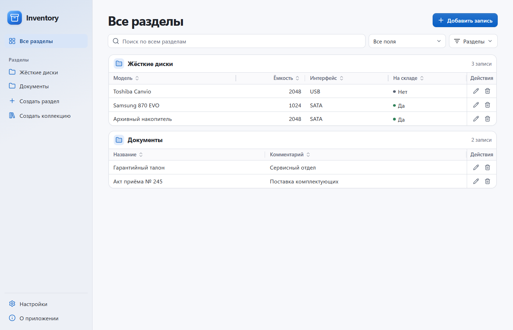

# Inventory

[](https://github.com/greedval-us/inventory/actions/workflows/ci.yml)
[](https://github.com/greedval-us/inventory/releases)
[](.nvmrc)
[](docs/guide.md#где-хранится-база)

**Inventory** — настольный реестр для Windows. Для дисков можно завести поля «Модель», «Ёмкость» и «Интерфейс», для документов — «Номер» и «Дата». На экране «Все разделы» у каждого раздела своя таблица, а один запрос находит совпадения сразу во всех. Данные хранятся в SQLite на компьютере пользователя.

[Скачать для Windows](https://github.com/greedval-us/inventory/releases) · [Руководство пользователя](docs/guide.md) · [Запуск из исходников](#разработка)



## Установка

Готовые сборки появляются на странице релизов после публикации тега версии. В разделе **Assets** выберите `Inventory-Setup-<версия>.exe` для установки или `Inventory-<версия>.exe` для запуска без установки. Оба варианта хранят базу в профиле пользователя Windows. [Релизы Inventory](https://github.com/greedval-us/inventory/releases)

При первом запуске нажмите **Создать раздел**, укажите название и поля. Затем нажмите **Добавить запись**. Например, запрос `245` на экране «Все разделы» покажет и диск с таким фрагментом серийного номера, и документ «Акт № 245».

## Возможности

| Задача | Как работает |
| --- | --- |
| Настроить форму записи | Текст, число, флажок, список, дата, дата со временем и месяц с годом. Для поля можно задать подсказку и сделать его обязательным. |
| Изменить структуру | Поля можно добавлять, переименовывать, перемещать и удалять. При переходе из текста в список Inventory собирает варианты из заполненных строк. Переименование варианта обновляет записи. |
| Организовать разделы | Разделы объединяются в коллекции. Перенос доступен через настройки раздела и перетаскиванием в боковой панели. |
| Найти записи | Поиск по фрагменту значения работает в разделе, коллекции и общем реестре. В общем реестре можно выбрать, какие таблицы показывать. |
| Настроить таблицу | Щелчок по заголовку меняет сортировку, третье нажатие возвращает исходный порядок. Ширина и сортировка сохраняются отдельно для каждого раздела. |
| Настроить оформление | Светлая, тёмная и системная темы, палитры, пять шрифтов и размер текста от 12 до 16 пикселей. |

## Разработка

Для разработки используются Electron, Vue 3, Pinia и встроенный в Node.js модуль `node:sqlite`. Установите Node.js 24 и выполните команды из корня репозитория.

```powershell
npm ci
npm run dev
```

Electron откроет окно с интерфейсом Vite. Изменения компонентов Vue видны сразу. После правок основного процесса перезапустите команду.

| Команда | Результат |
| --- | --- |
| `npm start` | Открывает приложение с локальной сборкой интерфейса |
| `npm test` | Запускает модульные тесты, включая проверки миграций SQLite |
| `npm run check` | Выполняет модульные тесты и собирает приложение |
| `npm run test:desktop` | Собирает интерфейс и проверяет работу Electron во временном профиле, в том числе после перезапуска |
| `npm run pack:win` | Собирает распакованное приложение в `release/win-unpacked/` |
| `npm run build:win` | Собирает установщик NSIS и переносимую версию в `release/` |

### Где искать код

| Каталог | Назначение |
| --- | --- |
| [src/renderer](src/renderer) | Страницы Vue, состояние Pinia, конструктор полей и таблицы реестра |
| [src/shared](src/shared) | Контракт между интерфейсом и Electron, типы полей и общие правила |
| [src/main](src/main) | Жизненный цикл приложения, окно, preload и обработчики IPC |
| [src/main/catalog](src/main/catalog) | Разделы, коллекции, записи, поиск и настройки таблиц |
| [src/main/database](src/main/database) | Подключение к SQLite и миграции существующих баз |
| [tests](tests) | Модульные тесты и сценарии работы с окнами Electron |

При запуске Electron собирает сервисы в `src/main/createApplicationServices.js`. Интерфейс Vue обращается к ним через `window.inventory` и preload. При создании раздела программа назначает таблице и столбцам постоянные имена в SQLite, например `inventory_1` и `f_1`. Поэтому пользователь может переименовать поле, сохранив его значения. Новые миграции добавляются в конец списка в `src/main/database/migrations.js`.

## Проверки и выпуск

GitHub Actions запускает тесты на Windows при обновлении `main` и при проверке pull request. [История проверок CI](https://github.com/greedval-us/inventory/actions/workflows/ci.yml)

Чтобы выпустить версию, сначала отправьте в `main` коммит с согласованными `package.json` и `package-lock.json`. Из этого коммита создайте и отправьте тег с версией пакета.

```powershell
$tag = 'v' + (Get-Content -Raw package.json | ConvertFrom-Json).version
git tag $tag
git push origin $tag
```

Сценарий проверяет версию, выполняет тесты и собирает два файла для Windows x64. Оба файла прикрепляются к соответствующему выпуску на GitHub. [Сценарий выпуска](.github/workflows/release.yml)

## Лицензии

Для самого приложения в `package.json` указано `UNLICENSED`. Лицензии Manrope и Cormorant Garamond и сведения об источнике кириллического шрифта «Гарри Поттер» находятся рядом с файлами шрифтов. [Сопроводительные файлы](src/renderer/public/fonts)
